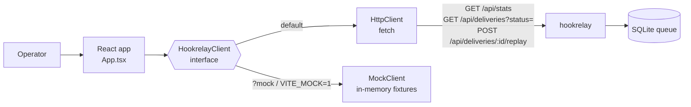

# hookrelay-console

[](https://github.com/ipenas-cl/hookrelay-console/actions/workflows/ci.yml)
 

**An operator console for [hookrelay](https://github.com/ipenas-cl/hookrelay).** It lets you see what's in the
webhook queue, see why a delivery died, and replay it with one click. Built with Vite, React and strict TypeScript.
There's a **mock mode**, so you can try it without running the backend.

- Live queue stats (pending, in flight, delivered, dead) with auto-refresh
- Status tabs, including a **dead-letter queue** view
- **Replay** a single delivery, or the whole DLQ
- Detail drawer: idempotency key, attempts, next retry, last error, pretty-printed payload (WhatsApp Cloud API shaped)
- A typed API client that mirrors hookrelay's JSON contract, plus an in-memory `MockClient` with the same semantics (for example, a `409` when you replay a pending event)

## Architecture



## Quickstart

```bash
npm install
npm run dev:mock                                        # no backend needed
# or, against a running hookrelay:
VITE_HOOKRELAY_URL=http://localhost:8080 npm run dev
```

You can also pick the backend at runtime: `http://localhost:5173/?api=http://relay.internal:8080`, or `?mock`.

Docker (static build on unprivileged nginx):

```bash
docker build --build-arg VITE_HOOKRELAY_URL=http://localhost:8080 -t hookrelay-console .
docker run -p 8081:8080 hookrelay-console
```

Full local stack:

```bash
# terminal 1
HOOKRELAY_SECRET=dev HOOKRELAY_TARGET_URL=http://localhost:9000 cargo run --manifest-path ../hookrelay/Cargo.toml
# terminal 2
npm run dev
```

## Design decisions

- **One interface, two implementations.** The UI depends only on `HookrelayClient`. The mock is good enough for demos and also serves as the test double, so component tests run the real app logic with no network mocking.
- **The mock enforces server rules** (only `dead` or `delivered` can be replayed, keyset pagination, newest first), so the UI can't drift into behavior the backend would reject.
- **Server state stays on the server.** After every mutation the app refetches stats and the list instead of patching local state optimistically. That way it is always consistent with the queue, which is what you want from an ops tool.
- **No UI framework or state library.** It is small, auditable and fast to load (about 49 KB gzipped).
- **Accessible by construction.** Tabs, alerts and the drawer use ARIA roles, and the tests query by role, the same way a user finds things.

## Development

```bash
npm run typecheck && npm test && npm run build
```

The tests (Vitest and Testing Library) cover the client contract (query building, error surfacing, replay semantics, pagination) and the UI flows: stats, DLQ filter, single and bulk replay, the detail drawer, and the error banner.

## License

MIT
